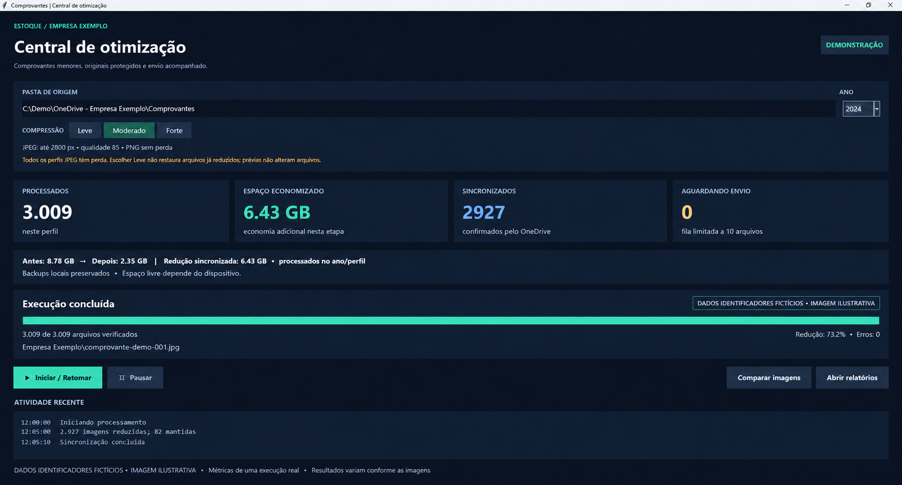

<div align="center">

# 🗜️ Comprovantes Optimizer

**Aplicativo desktop para reduzir imagens em lote, preservar backups e acompanhar a sincronização do OneDrive.**


[](https://github.com/ludolffbruno/comprovantes-optimizer/actions/workflows/tests.yml)

[Resultados](#-automação-na-prática) · [Funcionalidades](#-funcionalidades) · [Como executar](#%EF%B8%8F-como-executar) · [Privacidade](#-privacidade-e-segurança)

</div>

---

## 📊 Automação na prática

| Resultado de uma execução no perfil Moderado | Valor |
|---|---:|
| Arquivos processados | **3.009** |
| Imagens reduzidas e sincronizadas | **2.927** |
| Arquivos mantidos sem redução adicional | **82** |
| Tamanho antes → depois | **8,78 GB → 2,35 GB** |
| Economia | **6,43 GB · 73,2%** |
| Erros / envios pendentes ao concluir | **0 / 0** |

Automatizar esse trabalho evita abrir, salvar e conferir milhares de imagens individualmente: o programa percorre as subpastas, baixa os arquivos sob demanda, comprime, verifica, mantém backup e acompanha o envio.

**Métricas de uma execução real informadas pelo autor; valores arredondados.** Não representam garantia de redução. JPEG já comprimido, resolução, textura e perfil escolhido influenciam o resultado. O modo Moderado tem perda de resolução e compressão.



<sub>Recriação ilustrativa da interface por IA. Nomes, caminhos, arquivos e horários são fictícios; as métricas agregadas destacadas correspondem à execução descrita acima.</sub>

## ✨ Funcionalidades

- **Processamento por ano** — percorre empresas e subpastas em `ANO 2024`, por exemplo.
- **Três perfis JPEG** — Leve, Moderado e Forte, com PNG sem perda.
- **OneDrive sob demanda** — leitura integral hidrata o arquivo; o cliente instalado realiza o upload.
- **Verificação antes da troca** — dimensões, decodificação, metadados e qualidade por PSNR.
- **Backup verificado** — SHA-256 e original preservado antes de substituir.
- **Retomada por arquivo** — SQLite, journal durável e substituição atômica.
- **Migração de perfil** — busca originais na cadeia de backups, evitando recompressão acumulada.
- **Comparação visual** — original e atual/prévia, zoom e navegação sincronizados.
- **Painel de economia** — antes/depois, redução sincronizada, backups e disco livre.
- **Relatórios CSV/TXT** — resultado e falhas por arquivo.
- **Pausa segura** — conclui a etapa atual; inibe suspensão automática durante o trabalho.

## 🎚️ Perfis

| Perfil | Lado maior | Qualidade JPEG | PSNR mínimo* |
|---|---:|---:|---:|
| Leve | Resolução original | 93 | 32 dB |
| Moderado | Até 2800 px | 85 | 30 dB |
| Forte | Até 2000 px | 75 | 28 dB |

\* Comparado à referência redimensionada antes da codificação. Não é garantia de legibilidade de textos/assinaturas. Compare amostras antes de usar Forte em documentos importantes. Todos os perfis JPEG têm perda; qualidade 85 não significa 85% da qualidade preservada.

PNGs permanecem no Oxipng sem perda; imagens animadas e formatos não suportados são preservados. PDFs não são alterados. O programa só substitui quando o resultado é menor. Mudar para Leve não restaura detalhes de arquivos já reduzidos; restauração depende do backup.

## 🧰 Stack técnica

| Camada | Tecnologia |
|---|---|
| Linguagem / interface | Python 3.12+ · Tkinter/ttk |
| JPEG | Pillow · libjpeg-turbo/jpegtran |
| PNG | Oxipng |
| Progresso / integridade | SQLite · SHA-256 |
| Sincronização | Windows Cloud Files API · cliente OneDrive |
| Testes | unittest · GitHub Actions/Windows |

## ▶️ Como executar

### Pré-requisitos

- Windows 10/11 **x64**, Python 3.12+ com Tkinter.
- Cliente OneDrive conectado e sincronização ativa para processar sua pasta sincronizada.
- Internet para preparar dependências e hidratar/enviar arquivos.
- Espaço local para backups: economia no OneDrive não equivale a espaço livre no PC.

```powershell
git clone https://github.com/ludolffbruno/comprovantes-optimizer.git
cd comprovantes-optimizer
python -m venv .venv
.\.venv\Scripts\python.exe -m pip install -r requirements.txt
.\.venv\Scripts\python.exe setup_tools.py
.\.venv\Scripts\python.exe otimizador.py
```

Depois da preparação, também é possível abrir `INICIAR.cmd`.

O instalador baixa versões fixas de jpegtran/Oxipng, verifica os SHA-256 e guarda ferramentas e respectivas licenças em `tools/`, sem instalação global. Os binários nativos podem exigir o Microsoft Visual C++ Redistributable x64.

1. Use **Escolher pasta** para selecionar a pasta que contém os anos.
2. Escolha ano/perfil e confira uma amostra em **Comparar imagens**.
3. Clique **Iniciar / Retomar**. Abrir o programa não inicia processamento.
4. Ao concluir, confira erros e envios pendentes no relatório.

Estrutura esperada:

```text
Comprovantes/
└── ANO 2024/
    ├── Empresa Exemplo/
    │   └── comprovante-001.jpg
    └── Filial Exemplo/
        └── comprovante-002.png
```

Os anos disponíveis inicialmente são 2023–2026. O campo da pasta é configurável; nomes de empresas/subpastas são livres.

## 💾 Dados locais e recuperação

Dados ficam fora do repositório, em `%LOCALAPPDATA%\ComprovantesOptimizer`:

```text
ComprovantesOptimizer/
├── dados/               # Histórico do mecanismo sem perda e trava de instância
├── dados-leve/
├── dados-moderado/
└── dados-forte/
    ├── progresso.sqlite
    ├── backups/
    └── relatorio-2024.csv
```

Cada perfil possui progresso separado. Após queda de energia, reabra e use **Iniciar / Retomar**; não há reinício automático do Windows. Backups não são apagados automaticamente. Para restaurar, pause o programa e copie o caminho de backup indicado no CSV sobre o arquivo original; aguarde a sincronização.

Variáveis opcionais: `COMPROVANTES_ROOT` define a pasta inicial; `COMPROVANTES_OPTIMIZER_DATA` define a pasta de dados locais. Mantenha os dados fora da pasta de comprovantes. Não edite/mova os arquivos durante a execução.

### O que significa “sincronizado”?

É o estado informado pelo provedor OneDrive via `CfGetPlaceholderInfo`. Não é uma confirmação independente via Graph ou novo download remoto. Com dez pendências, o programa aguarda o envio do lote. No fim aguarda mais dois minutos e registra as pendências restantes para uma próxima execução. Não declara envio concluído quando a API informa estado desconhecido.

EXIF, ICC, XMP e comentários JPEG são preservados. Miniaturas e dimensões internas do EXIF continuam como no original; as dimensões reais ficam no cabeçalho JPEG.

## 🧪 Testes

```powershell
.\.venv\Scripts\python.exe -m unittest -v test_otimizador.py
```

15 testes de fluxo cobrem backup, interrupção antes/depois da troca, corrupção, alterações externas, três perfis, migração, cadeia de originais, cálculos de espaço e prévia sem alterar a entrada. Os testes usam imagens sintéticas em diretórios temporários; não usam arquivos operacionais.

## 🗂️ Estrutura do projeto

```text
comprovantes-optimizer/
├── assets/demo.png          # Imagem ilustrativa anonimizada
├── docs/                   # Privacidade e ferramentas de terceiros
├── otimizador.py            # Compressão, verificação, retomada e OneDrive
├── interface.py             # Painel desktop
├── comparador.py            # Comparação e prévias temporárias
├── perfis.py                # Perfis, métricas e cadeia de backups
├── test_otimizador.py
├── setup_tools.py           # Download e verificação de ferramentas
├── tools-manifest.json      # Proveniência, versões e hashes
├── requirements.txt
└── INICIAR.cmd
```

## 🔐 Privacidade e segurança

- Nenhuma foto, nota fiscal, backup, banco, inventário ou relatório operacional é publicado.
- A imagem demonstrativa usa identificadores fictícios. Apenas resultados agregados autorizados pelo autor aparecem no README.
- Sem credenciais ou tokens; o cliente OneDrive usa sua própria sessão local.
- `.gitignore` exclui dados operacionais, imagens privadas, binários baixados e configurações locais.
- Dependências gratuitas/open source preservam suas próprias licenças; consulte [ferramentas de terceiros](docs/THIRD_PARTY.md).

## 👤 Autor

**Bruno Ludolff** — [@ludolffbruno](https://github.com/ludolffbruno)
