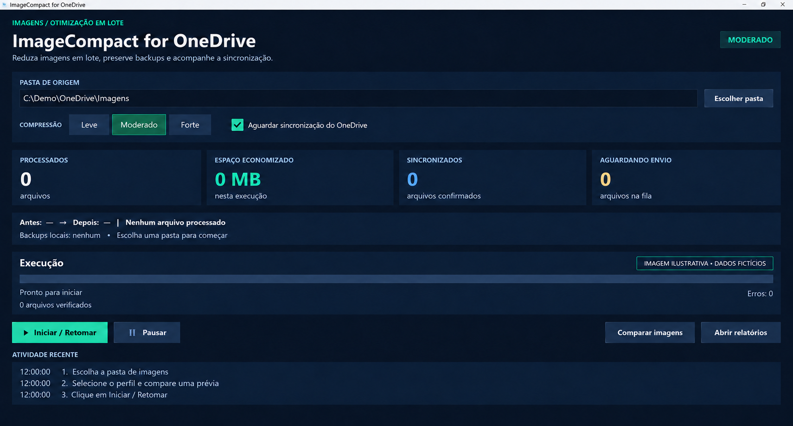

<div align="center">

# 🗜️ ImageCompact for OneDrive

**Reduza imagens em lote, preserve backups e acompanhe a sincronização do OneDrive.**


[](https://github.com/ludolffbruno/imagecompact-for-onedrive/actions/workflows/tests.yml)

[Como funciona](#-como-funciona) · [Perfis](#-perfis-de-compressão) · [Instalação](#%EF%B8%8F-instalação) · [Uso](#-como-usar) · [Privacidade](#-privacidade)

</div>

---

Aplicativo desktop para otimizar fotografias, imagens de produtos, digitalizações e outros arquivos JPEG/PNG. Escolha qualquer pasta: o programa percorre suas subpastas, valida cada resultado e substitui somente os arquivos que ficam menores.

Funciona com pastas locais e pastas sincronizadas pelo cliente OneDrive no Windows. Não exige nomes específicos de empresas, pastas ou anos.



<sub>Imagem ilustrativa produzida por IA, com dados fictícios e contadores zerados. Não representa resultados de processamento.</sub>

## 🔄 Como funciona

1. **Localiza** JPEGs e PNGs na pasta selecionada e em suas subpastas.
2. **Lê o conteúdo completo**; arquivos somente online são baixados pelo cliente OneDrive.
3. **Gera uma versão otimizada** com o perfil escolhido.
4. **Verifica o resultado**: decodificação, dimensões, metadados e limite de qualidade.
5. **Mantém backup e verifica seu SHA-256** antes de substituir o arquivo.
6. **Substitui apenas se ficar menor**, preservando o nome e o caminho.
7. **Registra o progresso** em SQLite e atualiza relatórios por pasta/perfil.
8. **Acompanha o envio pelo OneDrive**, quando essa opção está ativada.

A economia depende da resolução, conteúdo, formato e compressão existente. Uma imagem já otimizada pode permanecer igual. Não há percentual mínimo de economia prometido.

## ✨ Funcionalidades

- **Qualquer pasta** — sem estrutura por ano ou nome obrigatório.
- **Três perfis JPEG** — Leve, Moderado e Forte.
- **PNG sem perda** — mantém transparência, pixels e metadados verificados.
- **Comparação visual** — original e arquivo atual/prévia lado a lado, com zoom e navegação sincronizados.
- **Retomada** — progresso por arquivo e por perfil; reexecutar o mesmo perfil pula versões concluídas e inalteradas.
- **Backup antes da troca** — originais locais preservados; não são apagados automaticamente.
- **Migração de perfil** — usa a cadeia de backups verificados quando reconhece a versão atual.
- **Pausa segura** — aguarda a etapa atual; inibe suspensão automática enquanto trabalha.
- **Painel de espaço** — antes/depois, economia, tamanho dos backups e disco livre.
- **Relatórios CSV/TXT** — estado, tamanhos, erros e caminho do backup de cada arquivo.

## 🎚️ Perfis de compressão

| Perfil | Resolução JPEG | Qualidade JPEG | Quando considerar |
|---|---|---:|---|
| **Leve** | Mantém a resolução original | 93 | Priorizar detalhes e reduzir com menor agressividade |
| **Moderado** | Até 2800 px no lado maior | 85 | Equilibrar tamanho e qualidade para visualização habitual |
| **Forte** | Até 2000 px no lado maior | 75 | Priorizar tamanho, após comparar a legibilidade dos detalhes |

- Todos os perfis JPEG têm perda. Qualidade 85 não significa preservar 85% da qualidade original.
- Imagens menores nunca são ampliadas.
- PNG continua com otimização sem perda em todos os perfis.
- PDFs e formatos não suportados não são alterados. Imagens animadas são preservadas.
- Escolher Leve após uma redução anterior **não restaura detalhes**: se o novo resultado for maior, o arquivo atual é mantido. Recuperar qualidade exige restaurar o backup.

A verificação JPEG usa PSNR mínimo de 32/30/28 dB, respectivamente, contra a referência já redimensionada. Essa métrica não mede a perda causada pelo redimensionamento e não garante legibilidade de texto pequeno ou assinaturas. Use a comparação visual antes de processar imagens importantes.

## ▶️ Instalação

### Requisitos

- Windows 10/11 **x64**.
- Python 3.12+ com Tkinter.
- Espaço local suficiente para backups e arquivos temporários.
- Para o modo OneDrive: cliente instalado, conectado e sincronização ativa.

```powershell
git clone https://github.com/ludolffbruno/imagecompact-for-onedrive.git
cd imagecompact-for-onedrive
python -m venv .venv
.\.venv\Scripts\python.exe -m pip install -r requirements.txt
.\.venv\Scripts\python.exe setup_tools.py
.\.venv\Scripts\python.exe main.py
```

Depois da instalação, abra `INICIAR.cmd` para iniciar a interface.

`setup_tools.py` baixa jpegtran e Oxipng em versões fixadas, valida SHA-256 e salva ferramentas e licenças em `tools/`, sem instalação global. Os binários podem exigir o Microsoft Visual C++ Redistributable x64.

## 🧭 Como usar

1. Clique em **Escolher pasta** e selecione a pasta que deseja processar.
2. Selecione **Leve**, **Moderado** ou **Forte**.
3. Configure **Aguardar sincronização do OneDrive**:
   - **Marcado:** para uma pasta sincronizada pelo OneDrive; aguarda confirmação de envio.
   - **Desmarcado:** para uma pasta local; registra conclusão local, sem afirmar que houve upload.
4. Use **Comparar imagens** para examinar o arquivo atual ou uma prévia temporária do perfil. A prévia não altera os arquivos.
5. Clique **Iniciar / Retomar**. Abrir o programa ou trocar de perfil não inicia processamento.
6. Consulte os indicadores e **Abrir relatórios** ao concluir.

Exemplo de organização livre:

```text
Imagens/
├── fotografia.jpg
├── Produtos/
│   └── produto.png
└── Digitalizações/
    └── documento.jpeg
```

Selecione apenas a pasta que deseja otimizar. Para trabalhar com um subconjunto, escolha diretamente sua subpasta. Evite editar ou mover os arquivos durante a execução.

### Comparação visual

A esquerda mostra o original recuperado do backup; se não houver backup, identifica a entrada atual. A direita mostra o arquivo atual ou uma prévia do perfil. Use **+/−**, roda do mouse, **100%**, **Ajustar** e arraste para comparar a mesma região.

### OneDrive

O cliente OneDrive realiza download e upload usando sua sessão existente. O aplicativo consulta `CfGetPlaceholderInfo` para saber se o provedor informa sincronização; não utiliza Microsoft Graph nem faz um download remoto independente para verificar o envio.

Ao acumular dez pendências, aguarda automaticamente o lote. No final aguarda mais dois minutos e registra as pendências restantes para uma próxima execução. Se o OneDrive estiver pausado, offline ou indisponível, a confirmação pode não chegar. Mantenha-o ativo ou use o modo local quando apropriado.

## 💾 Progresso, backups e relatórios

Dados locais ficam fora do repositório:

```text
%LOCALAPPDATA%\ImageCompactForOneDrive
├── dados/
├── dados-leve/
├── dados-moderado/
└── dados-forte/
    ├── progresso.sqlite
    ├── backups/
    └── relatorio-pasta-<identificador>.csv
```

- Cada perfil tem progresso separado. Os relatórios distinguem pastas pelo identificador de seu caminho.
- Após uma interrupção, reabra e clique **Iniciar / Retomar**. Não há tarefa de inicialização automática do Windows.
- Pausar ou fechar aguarda a etapa atual; uma leitura sob demanda pode levar até cinco minutos.
- Bancos usam journal durável; a substituição é atômica, após backup e verificação.
- Backups permanecem locais. **Economia no OneDrive não equivale a espaço livre no disco.**
- O painel Antes → Depois considera os arquivos processados com sucesso na pasta/perfil selecionados. Backups abrangem todas as pastas/perfis do aplicativo.

| Estado | Significado |
|---|---|
| `synced` | Sincronização confirmada pelo provedor OneDrive |
| `local` | Salvo e verificado localmente; upload não verificado |
| `pending` | Substituído; confirmação/finalização pendente |
| `unchanged` | Sem redução adicional; arquivo atual mantido |
| `unsupported` | Formato preservado sem processamento |
| `error` / `conflict` | Falha ou alteração externa; consulte o relatório |

Para restaurar, pause o programa, localize o arquivo no CSV e copie o backup indicado sobre o caminho original. Ao recuperar uma versão anterior a múltiplos perfis, consulte a cadeia de backups. Não apague os bancos e backups enquanto precisar da recuperação.

EXIF, ICC, XMP e comentários JPEG são preservados. Miniaturas e dimensões internas do EXIF permanecem as originais; as dimensões reais ficam no cabeçalho JPEG.

### Configuração opcional

- `IMAGECOMPACT_ROOT`: pasta inicialmente exibida na interface.
- `IMAGECOMPACT_DATA`: pasta de dados, bancos e backups. Deve ficar fora da pasta processada.

## 🧰 Stack

Python · Tkinter/ttk · Pillow · Oxipng · libjpeg-turbo/jpegtran · SQLite · SHA-256 · Windows Cloud Files API.

As ferramentas de compressão são gratuitas/open source e mantêm suas próprias licenças. Consulte [ferramentas de terceiros](docs/THIRD_PARTY.md).

## 🧪 Testes

```powershell
.\.venv\Scripts\python.exe -m unittest -v test_optimizer.py
```

18 testes sintéticos cobrem compressão, metadados, backups, retomada, conflitos, perfis, comparação, métricas, pastas arbitrárias, relatórios separados e distinção entre conclusão local e sincronização. Não usam fotos ou documentos operacionais.

## 🗂️ Estrutura

```text
imagecompact-for-onedrive/
├── main.py                  # Entrada do aplicativo
├── optimizer.py             # Processamento, verificação e retomada
├── interface.py             # Painel desktop
├── comparador.py            # Comparação e prévias
├── perfis.py                # Perfis, métricas e backups
├── setup_tools.py           # Download verificado das ferramentas
├── tools-manifest.json
├── test_optimizer.py
├── assets/interface-demo.png
└── docs/
```

## 🔐 Privacidade

- O repositório não contém fotos, relatórios, inventários, bancos ou backups de usuários.
- A ilustração usa dados fictícios e não apresenta métricas de uma execução real.
- Credenciais e tokens do OneDrive não são armazenados pelo aplicativo.
- `.gitignore` bloqueia arquivos operacionais, imagens privadas e dependências baixadas.

## 👤 Autor

**Bruno Ludolff** — [@ludolffbruno](https://github.com/ludolffbruno)
